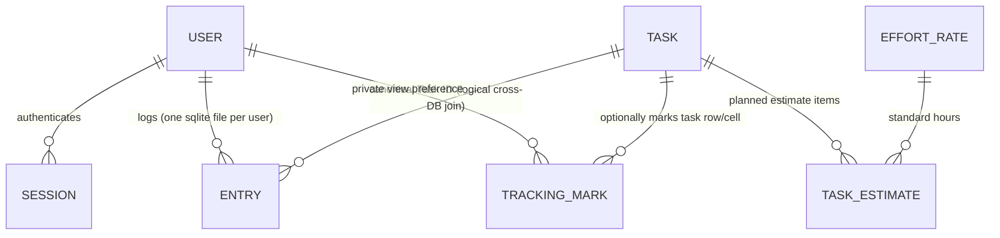

# Aventics WorkTrack — Data relationships

## Ownership and persistence

| Entity | Key | Location | Meaning |
|---|---|---|---|
| User | `users.id` | `shared/catalog.sqlite` | Login identity and ownership of engineer effort directory |
| Task | `tasks.id` | `shared/catalog.sqlite` | 32-column Task Tracking record, project, engineers, statuses and estimates |
| Entry | `entries.id` | `users/{id}/effort.sqlite` | One dated log (Date, Task ID, Kind, Role, Hours, Note) |
| Effort Rate | `effort_rates.id` | `shared/catalog.sqlite` | Reusable category/difficulty/code and base EX/QC hours |
| Estimate Item | `task_estimates.id` | `shared/catalog.sqlite` | References one Task and one rate; stores qty, experience, factor and computed hours |
| Tracking Mark | `(user_id,scope,task_id,column_key)` | `shared/catalog.sqlite` | Per-user highlight/text color/pin for row, column, or cell |
| Session | SHA-256 token hash | `shared/catalog.sqlite` | Authentication state; cookie is HttpOnly / SameSite Strict |

## How values flow

1. **Task Tracking** holds canonical Task IDs such as `3792-ip1614`; project is `ip1614`, while serial and revision are separate attributes. The task's **Engineer** and **QC Engineer** describe assignment, not whose hours can be counted.
2. **Timesheet** entries are attributed to the authenticated engineer's own database and carry a canonical Task ID for project work. EX and QC roles determine execution versus quality-control actuals. Non-project entries have no Task ID and Role `NA`.
3. **Legacy import aliases**: an input Task ID with a description suffix (e.g. `3792-ip1614_series: nl4`) maps to a canonical Task ID only when exactly one task has that numeric serial/project prefix. No loose fuzzy matching is performed.
4. **Actual EX/QC effort** is computed from dated entries plus optional imported undated historical baseline fields. It does **not** come from the estimation rate table.
5. **Estimation & Lookup** returns reference EX/QC hours based on Activity and Difficulty. The preview formula for each line is `round_to_0.1(reference_hours × quantity × experience_factor)`. The factor is 1.00, 0.90, or 0.80.
6. **Saved estimation lines** are linked to a Task ID. Applying estimates is a separate admin-confirmed write to `tasks.estimated_ex` and `tasks.estimated_qc`. It never changes any entry or actual hours.
7. **Pin/highlight/text-color marks** belong to the current user. A mark changes the UI only; it never changes the underlying task row or another user's view.

## Import rules and limitations

- Full-workbook import reads `Task Tracking` and the wide dated `Timesheet` from the same .xlsx source.
- Each positive cell becomes an Entry. Blank/zero cells do not create or delete records.
- Task Tracking is imported before dated effort. Missing engineer accounts may be provisioned as **inactive** when an admin explicitly selects that option.
- The importer recovers task statuses from the Timesheet only when the normalized task has one unambiguous status. Conflicting statuses need manual review.
- Duplicate entries are updated by the existing per-user unique key `(date,task_id,kind,role,note)`. A cell with existing annotated notes cannot be silently overwritten.
- Shared task writes are transactional in shared SQLite; engineer effort writes are transactional **per user**, not atomically across all engineer databases.
- Never store live SQLite databases on a remote SMB share. Run only one API process writing them. Back up online using SQLite-aware methods and test combined restoration.
- Import/export and estimation reference files can contain company-sensitive data: store them on the internal server, not in a public Git repository.

## Outstanding production safeguards

Corporate SSO, edit audit trails, concurrency/revision handling, database online backup and restore, role policies, larger-year-grid performance tests and end-to-end import checks still require production hardening.
